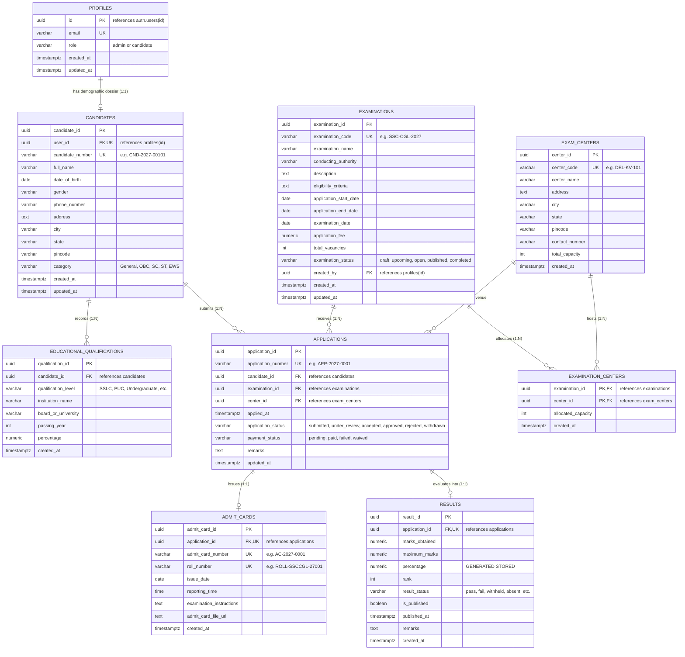
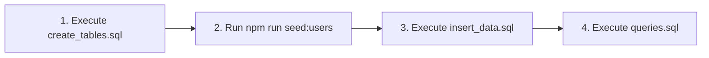

# Government Recruitment Examination Management System (GREMS)
### College DBMS Mini Project • Full-Stack Web Application

[](https://react.dev/)
[](https://tailwindcss.com/)
[](https://nodejs.org/)
[-336791?logo=postgresql&logoColor=white)](https://supabase.com/)
[-blueviolet)](https://supabase.com/docs/guides/auth/row-level-security)

---

## 📌 1. Project Overview

The **Government Recruitment Examination Management System (GREMS)** is a comprehensive, production-ready full-stack database management application designed for public service commission examination operations. It models the complete recruitment lifecycle from exam notification publishing to final merit list scorecard publication.

### Key Capabilities:
- **Candidate Portal**: Registration, personal demographic profile, multi-tier educational qualifications, examination browsing, eligibility verification, online application, official admit card / hall ticket viewing and printing, and declared scorecard lookup.
- **Administrative Portal**: Complete recruitment lifecycle governance, accredited test center capacity and quota allocations, candidate application scrutiny (acceptance/rejection), automated roll number issuance, marks recording, and merit ranking publication.
- **Relational Integrity**: Built on PostgreSQL with 9 normalized relational tables in Third Normal Form (3NF), UUID primary keys, composite keys, strict check constraints, foreign key cascades, capacity validation triggers, and Row Level Security (RLS) policies.
- **Dual Runtime Architecture**:
  1. **Academic In-Memory Evaluation Mode**: Self-contained fallback store seeded with realistic Indian government examination data enables immediate professor evaluation and local testing out-of-the-box without requiring live Supabase credentials.
  2. **Supabase Cloud PostgreSQL Mode**: Enterprise cloud database deployment using Supabase Auth (`auth.users`), PL/pgSQL triggers, automated profile provisioning, and Row Level Security.

---

## 🛠️ 2. Technology Stack

| Layer | Technologies Used |
| :--- | :--- |
| **Frontend** | React 18, Vite, JavaScript, Tailwind CSS, React Router DOM v6, Axios, Lucide React icons |
| **Backend** | Node.js, Express.js REST API, `@supabase/supabase-js`, JSON Web Tokens (JWT), Bcrypt.js, CORS, Dotenv |
| **Database** | PostgreSQL 15+ via Supabase Cloud, Row Level Security (RLS), PL/pgSQL triggers, B-Tree indexes, Range Partitioning |
| **Styling** | Government portal slate/navy palette, responsive tables, printable admit card media queries |

---

## 🏛️ 3. Relational Database Design (9 Tables + 1 Lab Partition Table)

The database strictly complies with Third Normal Form (3NF) to eliminate data redundancy and ensure relational integrity:



### Table Summary:
1. **`profiles`**: Bridges authentication with system roles (`admin`, `candidate`). Linked 1:1 with `auth.users`.
2. **`candidates`**: Aspirant personal profile (`candidate_number`, name, DOB, category, phone, address).
3. **`educational_qualifications`**: Multi-tier qualifications (`SSLC`, `PUC`, `Undergraduate`, `Postgraduate`, `Doctorate`, etc.) with percentage and passing year.
4. **`examinations`**: Government recruitment notices (`examination_code`, `examination_name`, vacancies, eligibility, fees, application deadlines, examination date).
5. **`exam_centers`**: Physical examination test venues (`center_code`, address, city, state, total seating capacity).
6. **`examination_centers`**: Junction table `(examination_id, center_id)` linking approved venues and allocated seat quotas per test.
7. **`applications`**: Candidate examination submissions (`application_number`, `applied_at`, `application_status`, `payment_status`, scrutiny remarks).
8. **`admit_cards`**: Official hall tickets (`admit_card_number`, `roll_number`, `issue_date`, `reporting_time`, examination instructions).
9. **`results`**: Evaluation scorecards (`marks_obtained`, `maximum_marks`, generated `percentage`, `rank`, `result_status`, `is_published`, `published_at`).
10. **`examination_archives_partitioned`**: Academic demonstration object implementing PostgreSQL Declarative Range Partitioning by `examination_date` into quarterly sub-partitions (`exams_q1_2026` through `exams_q4_2026`).

---

## 🚀 4. Quick Start & Local Execution

### Prerequisites
- **Node.js** (v18.0.0 or higher)
- **npm** (v9.0.0 or higher)

### Step 1: Install Dependencies
```bash
# Install backend dependencies
cd backend
npm install

# Install frontend dependencies
cd ../frontend
npm install
```

### Step 2: Configure Environment Variables

**Backend (`backend/.env`):**
```env
PORT=5000
NODE_ENV=development
FRONTEND_URL=http://localhost:3000

# Supabase Credentials (leave unconfigured to run in Zero-Setup In-Memory Mode)
SUPABASE_URL=https://your-project-id.supabase.co
SUPABASE_ANON_KEY=your-supabase-anon-key
SUPABASE_SERVICE_ROLE_KEY=your-supabase-service-role-key

# JWT Secret for fallback auth verification
JWT_SECRET=grems_academic_secure_jwt_secret_key_2026
```

**Frontend (`frontend/.env`):**
```env
VITE_API_URL=http://localhost:5000/api
```

> [!NOTE]
> The Vite frontend development server runs on **port 3000** (`http://localhost:3000`) and includes a configured proxy forwarding `/api/*` to the backend on **port 5000** (`http://localhost:5000`).

### Step 3: Run the Application

In terminal 1 (Backend API):
```bash
cd backend
npm start
# Server listens at http://localhost:5000
```

In terminal 2 (Frontend Client):
```bash
cd frontend
npm run dev
# Vite runs at http://localhost:3000
```

Open your browser at **`http://localhost:3000`** to access the web application.

---

## 🔐 5. Default Demonstration Accounts

Use these pre-configured credentials to evaluate both administrative and candidate workflows:

| Role | Email | Password | Candidate / Admin Identifier | Key Workflows Available |
| :--- | :--- | :--- | :--- | :--- |
| **Administrator** | `admin@gov.in` | `Admin@123` | Chief Examination Controller | Create exams, allocate centers, scrutinize applications, issue hall tickets, grade scores & publish results |
| **Candidate 1** | `rahul.sharma@example.com` | `Candidate@123` | `CND-2027-00101` (Rahul Sharma) | Has approved application for SSC CGL 2027, issued Admit Card, and declared Rank 1 Scorecard |
| **Candidate 2** | `priya.patel@example.com` | `Candidate@123` | `CND-2027-00102` (Priya Patel) | Has approved application for SSC CGL 2027, issued Admit Card, and declared Rank 2 Scorecard |
| **Candidate 3** | `amit.kumar@example.com` | `Candidate@123` | `CND-2027-00103` (Amit Kumar) | Has approved application for RRB NTPC 2027, issued Admit Card, and declared Rank 1 Scorecard |

---

## 🗄️ 6. Supabase Cloud PostgreSQL Setup Order

When deploying to a live Supabase PostgreSQL database, follow this exact sequential order:



### Step 1: Execute `create_tables.sql` in Supabase SQL Editor
1. Log in to [Supabase Dashboard](https://supabase.com/dashboard) and open the **SQL Editor**.
2. Copy the entire contents of [`database/schema/create_tables.sql`](file:///C:/Users/UJWAL/DBMS%20Mini%20-%20Project/database/schema/create_tables.sql).
3. Click **Run**. This establishes:
   - 9 relational tables + 1 range-partitioned demonstration table.
   - B-Tree indexes on foreign keys and search attributes.
   - 7 production triggers for automated profile creation, timestamps, and capacity validation.
   - Row Level Security (RLS) policies enforcing candidate data isolation.

### Step 2: Seed Demonstration Users via Admin API
In your terminal, navigate to `backend` and run:
```bash
cd backend
npm run seed:users
```
This script calls the Supabase Admin API (`service_role` key) to create the four demonstration accounts (`admin@gov.in`, `rahul.sharma@example.com`, `priya.patel@example.com`, `amit.kumar@example.com`), marks their emails as verified, and elevates `admin@gov.in` to `role = 'admin'` in `public.profiles`.

### Step 3: Execute `insert_data.sql` in Supabase SQL Editor
1. Open [`database/sample_data/insert_data.sql`](file:///C:/Users/UJWAL/DBMS%20Mini%20-%20Project/database/sample_data/insert_data.sql).
2. Copy and paste it into the Supabase SQL Editor.
3. Click **Run**. The script validates the prerequisite profiles and idempotently populates:
   - 3 Candidates
   - 8 Educational Qualifications
   - 3 Active Recruitment Examinations (2027 schedules)
   - 4 Accredited Exam Centers
   - 7 Center Quota Allocations
   - 4 Applications
   - 3 Issued Admit Cards
   - 3 Published Results

### Step 4: Execute Laboratory Queries from `queries.sql`
Open [`database/queries/queries.sql`](file:///C:/Users/UJWAL/DBMS%20Mini%20-%20Project/database/queries/queries.sql) in your SQL client (psql, pgAdmin, DBeaver) or Supabase SQL Editor to test **5 lab experiments with 23 queries (plus Experiment 6 with 6 additional queries)** following the CS522L5C DBMS lab manual pedagogy. All queries run safely inside a dedicated `grems_lab` schema.

---

## ⚡ 7. Active Database Triggers

The database schema enforces business logic and relational integrity through **7 real PostgreSQL triggers**:

| # | Trigger Name | Table | Event | Function | Business Purpose |
|:--|:---|:---|:---|:---|:---|
| 1 | `on_auth_user_created` | `auth.users` | `AFTER INSERT` | `handle_new_user()` | Automatically provisions a `public.profiles` row with strict `role = 'candidate'` when a user signs up. |
| 2 | `trg_profiles_updated_at` | `public.profiles` | `BEFORE UPDATE` | `set_updated_at()` | Automatically updates `updated_at` timestamp on profile edits. |
| 3 | `trg_candidates_updated_at` | `public.candidates` | `BEFORE UPDATE` | `set_updated_at()` | Automatically updates `updated_at` timestamp on candidate dossier edits. |
| 4 | `trg_examinations_updated_at` | `public.examinations` | `BEFORE UPDATE` | `set_updated_at()` | Automatically updates `updated_at` timestamp on examination notices. |
| 5 | `trg_applications_updated_at` | `public.applications` | `BEFORE UPDATE` | `set_updated_at()` | Automatically updates `updated_at` timestamp on application reviews. |
| 6 | `trg_validate_center_allocation` | `public.examination_centers` | `BEFORE INSERT OR UPDATE` | `check_center_allocation_capacity()` | Validates that the sum of seats allocated across all exams scheduled on the same date does not exceed the center's total physical capacity. |
| 7 | `trg_validate_application_center_capacity` | `public.applications` | `BEFORE INSERT OR UPDATE` | `check_application_center_capacity()` | Ensures candidates cannot be assigned to an exam center once the allocated capacity quota for that examination has been reached. |

---

## 📂 8. Project Folder Structure

```
government-recruitment-management-system/
│
├── frontend/
│   ├── public/
│   ├── src/
│   │   ├── assets/
│   │   ├── components/
│   │   │   ├── common/       # Badge, Modal, StatsCard, LoadingSpinner, Alert, EmptyState
│   │   │   ├── layout/       # Navbar, Footer, CandidateSidebar, AdminSidebar, DashboardLayout
│   │   │   ├── dashboard/
│   │   │   └── forms/
│   │   ├── pages/            # 21 complete React pages (Candidate, Admin, and Public portals)
│   │   ├── services/         # api.js with Axios interceptors & JWT handling
│   │   ├── hooks/
│   │   ├── context/          # AuthContext with role-based auth state
│   │   ├── routes/           # AppRoutes, ProtectedRoute, AdminRoute
│   │   ├── utils/            # helpers.js (formatting, badge variants)
│   │   ├── App.jsx
│   │   ├── main.jsx
│   │   └── index.css         # Tailwind styles & printable hall ticket media queries
│   ├── .env.example
│   ├── .env
│   ├── index.html
│   ├── vite.config.js        # Port 3000 & /api proxy to backend
│   ├── tailwind.config.js
│   ├── postcss.config.js
│   └── package.json
│
├── backend/
│   ├── config/
│   │   └── supabase.js       # Supabase client initializer with automatic fallback detection
│   ├── controllers/          # 9 modular REST API controllers
│   ├── routes/               # 9 Express route definitions
│   ├── middleware/           # authMiddleware (JWT & RBAC), errorHandler
│   ├── services/             # supabaseService.js with dual Supabase/In-Memory store
│   ├── scripts/
│   │   └── seedSupabaseUsers.js # Admin API seeder for demo accounts (npm run seed:users)
│   ├── utils/                # responseHelper.js, generators.js (CND-, APP-, AC-, ROLL-)
│   ├── server.js             # Express application entrypoint
│   ├── .env.example
│   ├── .env
│   └── package.json          # Includes "seed:users" script
│
├── database/
│   ├── schema/
│   │   └── create_tables.sql # Complete 9-table schema + 1 partition table + 7 triggers + RLS
│   ├── sample_data/
│   │   └── insert_data.sql   # Realistic, idempotent dummy dataset with prerequisite validation
│   ├── queries/
│   │   └── queries.sql       # 5 lab experiments with 23 queries (plus Exp 6 with 6 additional queries)
│   └── README.md             # Comprehensive database manual, execution order & schema guide
│
├── docs/
│   ├── database-design.md    # Data dictionary, 3NF normalization, triggers & referential integrity
│   ├── er-diagram.md         # Mermaid ER diagram & cardinality specifications
│   ├── api-documentation.md  # Exhaustive REST API specification & dual-mode auth guide
│   └── project-architecture.md# 3-tier architecture, RBAC model & data flow diagrams
│
├── .gitignore
└── README.md
```

---

## 📡 9. REST API Endpoints Overview (24 Endpoints)

| Method | Endpoint | Access | Description |
| :--- | :--- | :--- | :--- |
| `POST` | `/api/auth/register` | Public | Register new candidate account |
| `POST` | `/api/auth/login` | Public | Authenticate user & issue JWT token |
| `GET` | `/api/auth/me` | Authenticated | Retrieve current session and profile |
| `GET` | `/api/candidates` | Admin | Retrieve all registered candidates |
| `GET` | `/api/candidates/me` | Candidate | Retrieve authenticated candidate profile |
| `PUT` | `/api/candidates/:id` | Authenticated | Update candidate profile details |
| `GET` | `/api/qualifications` | Authenticated | List candidate educational records |
| `POST` | `/api/qualifications` | Candidate | Add academic qualification record |
| `DELETE` | `/api/qualifications/:id` | Candidate | Delete qualification record |
| `GET` | `/api/examinations` | Public | List published government examinations |
| `POST` | `/api/examinations` | Admin | Publish new recruitment examination notice |
| `PUT` | `/api/examinations/:id` | Admin | Update examination details / dates |
| `GET` | `/api/centers` | Authenticated | List physical examination venues |
| `POST` | `/api/centers` | Admin | Register new examination center |
| `POST` | `/api/centers/assign` | Admin | Map center to examination with seat quota |
| `GET` | `/api/applications` | Authenticated | List applications (role-filtered) |
| `POST` | `/api/applications` | Candidate | Submit application for an active examination |
| `PUT` | `/api/applications/:id/status`| Admin | Scrutinize application (`accepted`, `rejected`) |
| `GET` | `/api/admit-cards` | Authenticated | List admit cards (role-filtered) |
| `POST` | `/api/admit-cards/generate` | Admin | Issue official admit card with roll number |
| `GET` | `/api/results` | Authenticated | List examination results |
| `POST` | `/api/results` | Admin | Record candidate evaluation score |
| `PUT` | `/api/results/:id/publish` | Admin | Publish scorecard to candidate portal |
| `GET` | `/api/dashboard/candidate` | Candidate | Candidate dashboard analytics |
| `GET` | `/api/dashboard/admin` | Admin | High-level administrative KPIs & metrics |

---

## 🧪 10. End-to-End Verification Walkthrough

You can test the entire recruitment lifecycle via curl or directly in the UI:

### Scenario 1: Candidate Applies for Examination
```bash
# 1. Login as Candidate (Rahul Sharma)
curl -X POST http://localhost:5000/api/auth/login \
  -H "Content-Type: application/json" \
  -d '{"email":"rahul.sharma@example.com","password":"Candidate@123"}'

# 2. Candidate Submits Application for UPSC CSE 2027
curl -X POST http://localhost:5000/api/applications \
  -H "Content-Type: application/json" \
  -H "Authorization: Bearer <CANDIDATE_TOKEN>" \
  -d '{"examination_id":"e1000000-0000-0000-0000-000000000002","center_id":"f1000000-0000-0000-0000-000000000001"}'
```

### Scenario 2: Admin Scrutiny, Admit Card & Result Publication
```bash
# 1. Login as Administrator
curl -X POST http://localhost:5000/api/auth/login \
  -H "Content-Type: application/json" \
  -d '{"email":"admin@gov.in","password":"Admin@123"}'

# 2. Admin Accepts Application
curl -X PUT http://localhost:5000/api/applications/b1000000-0000-0000-0000-000000000004/status \
  -H "Content-Type: application/json" \
  -H "Authorization: Bearer <ADMIN_TOKEN>" \
  -d '{"application_status":"accepted","remarks":"Documents scrutinized and approved."}'

# 3. Admin Generates Official Admit Card
curl -X POST http://localhost:5000/api/admit-cards/generate \
  -H "Content-Type: application/json" \
  -H "Authorization: Bearer <ADMIN_TOKEN>" \
  -d '{"application_id":"b1000000-0000-0000-0000-000000000004","reporting_time":"08:30:00"}'

# 4. Admin Grades Score and Publishes Scorecard
curl -X POST http://localhost:5000/api/results \
  -H "Content-Type: application/json" \
  -H "Authorization: Bearer <ADMIN_TOKEN>" \
  -d '{"application_id":"b1000000-0000-0000-0000-000000000004","marks_obtained":89.50,"maximum_marks":100,"rank":1,"result_status":"pass"}'
```

---

## 🏷️ 11. GitHub Repository Metadata

- **Suggested Repository Description**:
  > Government Recruitment Examination Management System (GREMS) — Academic DBMS Mini Project built with React 18, Node.js Express, and PostgreSQL (Supabase) in 3NF with Row Level Security, capacity triggers, and practical SQL lab queries.

- **Suggested Topics / Tags**:
  `dbms-mini-project`, `postgresql`, `supabase`, `react`, `vite`, `tailwindcss`, `expressjs`, `database-design`, `sql-queries`, `row-level-security`, `full-stack`

---

## 📄 12. Academic Submission Details

- **Project Title**: Government Recruitment Examination Management System (GREMS)
- **Course**: CS522L5C – Database Management System Laboratory
- **Domain**: Database Management Systems (DBMS) / Full-Stack Web Development
- **Database Engine**: PostgreSQL 15+ (Supabase Cloud)
- **Normalization Level**: Third Normal Form (3NF)
- **Architecture**: 3-Tier Client-Server REST Architecture with Role-Based Access Control
