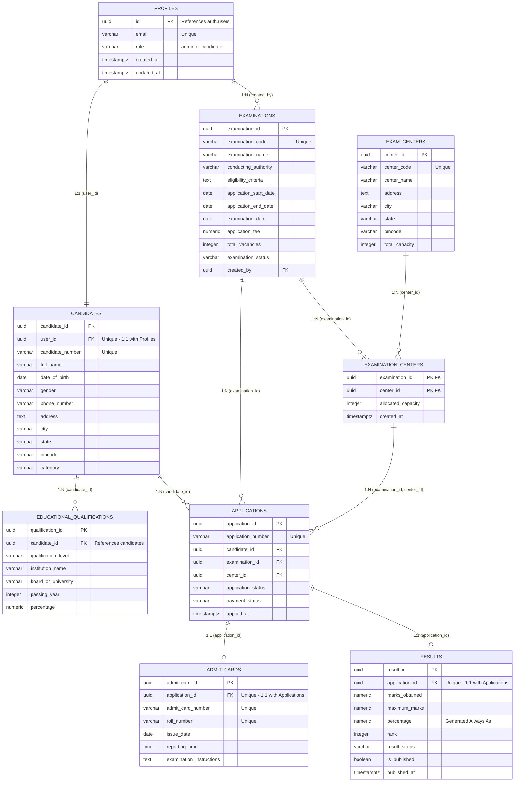

# Database Relationships & Entity-Relationship (ER) Architecture
**Project:** Government Recruitment Examination Management System (GREMS)  
**Database Engine:** PostgreSQL 15+ / Supabase  
**Course Code Reference:** CS522L5C (DBMS Mini-Project & Viva Voce Guide)  

---

## 1. Executive Summary

The **Government Recruitment Examination Management System (GREMS)** relational database is engineered around **nine strongly normalized tables** operating in **Third Normal Form (3NF)** and **Boyce-Codd Normal Form (BCNF)**.

The architecture models the complete, end-to-end recruitment lifecycle of public service commissions (e.g. UPSC, SSC, State PSCs):
1. **User Identity & Role Governance:** Secure separation between authentication profiles and personal biographical data.
2. **Academic Verification:** Multi-tier educational qualification management.
3. **Examination Publishing:** Notification broadcast, vacancy declarations, and eligibility standards.
4. **Venue Logistics & Capacity Control:** Physical testing centers and seat quota allocations resolving many-to-many relationships.
5. **Application Lifecycle:** Scrutiny workflows with uniqueness constraints preventing duplicate submissions.
6. **Hall Ticket Issuance:** Generated admit cards strictly bound to accepted applications.
7. **Merit Scoring & Publication:** Automated calculation of percentages and merit rank derivation.

---

## 2. Entity-Relationship (ER) Diagram

---

## 3. Detailed Relationship Analysis

### Relationship 1: `profiles` to `candidates` (One-to-One / 1:1)
* **Parent Table:** `public.profiles` (Primary Key: `id`)
* **Child Table:** `public.candidates` (Foreign Key: `user_id`)
* **Relational Multiplicity:** `1:1`
* **Integrity Constraint:** `UNIQUE (user_id)` and `FOREIGN KEY (user_id) REFERENCES public.profiles(id) ON DELETE CASCADE`.
* **DBMS Explanation:**
  Separates access authentication credentials from biographical identity. Each registered login account corresponds to at most one candidate biographical dossier. Deleting a profile cascades to delete the candidate biographical details automatically.

---

### Relationship 2: `candidates` to `educational_qualifications` (One-to-Many / 1:N)
* **Parent Table:** `public.candidates` (Primary Key: `candidate_id`)
* **Child Table:** `public.educational_qualifications` (Foreign Key: `candidate_id`)
* **Relational Multiplicity:** `1:N`
* **Integrity Constraint:** `FOREIGN KEY (candidate_id) REFERENCES public.candidates(candidate_id) ON DELETE CASCADE`.
* **DBMS Explanation:**
  Recruitment examinations require checking multiple qualification tiers (10th/SSLC, 12th/PUC, Undergraduate Degree, Postgraduate Degree). A candidate can register arbitrary multiple academic qualifications. Deleting a candidate cascades to clean up all associated degree rows.

---

### Relationship 3: `candidates` to `applications` (One-to-Many / 1:N)
* **Parent Table:** `public.candidates` (Primary Key: `candidate_id`)
* **Child Table:** `public.applications` (Foreign Key: `candidate_id`)
* **Relational Multiplicity:** `1:N`
* **Integrity Constraint:** `FOREIGN KEY (candidate_id) REFERENCES public.candidates(candidate_id)` (RESTRICT by default).
* **DBMS Explanation:**
  One candidate can apply for multiple independent recruitment notifications over their career (e.g., applying for both SSC CGL and UPSC CSE). However, referential deletion is restricted: a candidate cannot be deleted if active applications exist, protecting legal audit trails.

---

### Relationship 4: `examinations` to `applications` (One-to-Many / 1:N)
* **Parent Table:** `public.examinations` (Primary Key: `examination_id`)
* **Child Table:** `public.applications` (Foreign Key: `examination_id`)
* **Relational Multiplicity:** `1:N`
* **Integrity Constraint:** `FOREIGN KEY (examination_id) REFERENCES public.examinations(examination_id)` (RESTRICT).
* **Business Rule:** `UNIQUE (candidate_id, examination_id)`.
* **DBMS Explanation:**
  An examination notice receives thousands of applicant submissions. The composite unique constraint `(candidate_id, examination_id)` enforces at the relational level that a candidate cannot submit duplicate applications for the same notification.

---

### Relationship 5 & 6: Many-to-Many Resolution (`examinations` <-> `exam_centers`) via `examination_centers`
* **Problem:** 
  An examination is conducted simultaneously across dozens of regional test venues. Conversely, a single university or college test venue hosts dozens of different competitive examinations throughout the academic calendar year.
  This constitutes a classical **Many-to-Many (N:M)** relationship.
* **Relational Solution:**
  The junction (bridge) table `public.examination_centers` resolves this into two **One-to-Many (1:N)** relationships:
  1. `examinations` (1) to `examination_centers` (N)
  2. `exam_centers` (1) to `examination_centers` (N)
* **Composite Primary Key:** `(examination_id, center_id)`
* **Foreign Keys:**
  * `examination_id REFERENCES public.examinations(examination_id) ON DELETE CASCADE`
  * `center_id REFERENCES public.exam_centers(center_id) ON DELETE CASCADE`
* **Payload Attribute:**
  * `allocated_capacity INTEGER NOT NULL`: Dictates the specific quota of seats reserved at that physical venue for that particular examination.

---

### Relationship 7: `applications` to `admit_cards` (One-to-One / 1:1)
* **Parent Table:** `public.applications` (Primary Key: `application_id`)
* **Child Table:** `public.admit_cards` (Foreign Key: `application_id`)
* **Relational Multiplicity:** `1:1`
* **Integrity Constraint:** `UNIQUE (application_id)` and `FOREIGN KEY (application_id) REFERENCES public.applications(application_id) ON DELETE CASCADE`.
* **DBMS Explanation:**
  An admit card is generated strictly after an application has been reviewed and accepted. Each approved application produces exactly one hall ticket with a unique roll number. Deleting an application automatically cascades to remove the associated admit card.

---

### Relationship 8: `applications` to `results` (One-to-One / 1:1)
* **Parent Table:** `public.applications` (Primary Key: `application_id`)
* **Child Table:** `public.results` (Foreign Key: `application_id`)
* **Relational Multiplicity:** `1:1`
* **Integrity Constraint:** `UNIQUE (application_id)` and `FOREIGN KEY (application_id) REFERENCES public.applications(application_id) ON DELETE CASCADE`.
* **Generated Column:**
  * `percentage NUMERIC(5,2) GENERATED ALWAYS AS (ROUND((marks_obtained / NULLIF(maximum_marks, 0)) * 100, 2)) STORED`.
* **DBMS Explanation:**
  Every evaluated exam application receives exactly one official scorecard. The percentage column is computed automatically by PostgreSQL without manual calculations, preventing rounding divergence and discrepancies.

---

## 4. Normalization Justification

| Normal Form | Requirement | How GREMS Complies |
| :--- | :--- | :--- |
| **First Normal Form (1NF)** | All column values are atomic; no repeating groups or comma-separated lists. | Every attribute (phone numbers, addresses, categories) is atomic. Multiple qualifications are modeled in a dedicated relation (`educational_qualifications`) rather than a delimited array. |
| **Second Normal Form (2NF)** | Must be in 1NF, and all non-key attributes must be fully functionally dependent on the entire primary key (no partial dependencies). | In all tables with simple keys, 2NF holds trivially. In the junction table `examination_centers` with composite key `(examination_id, center_id)`, the only non-key attribute is `allocated_capacity`, which depends on BOTH the exam and the center. |
| **Third Normal Form (3NF)** | Must be in 2NF, and no transitive dependencies exist (non-key attributes depend only on the primary key, $X \to Y$ where $X$ is a superkey). | Candidates' personal details are not stored inside `applications` (only `candidate_id` is stored). Exam center physical properties (address, city, total capacity) are stored in `exam_centers`, not repeated in `applications`. |
| **Boyce-Codd Normal Form (BCNF)** | For every functional dependency $X \to Y$, $X$ must be a superkey. | All functional determinants in all nine tables are candidate keys (`id`, `candidate_id`, `examination_code`, `center_code`, `application_number`, `admit_card_number`, `roll_number`). |

---

## 5. Referential Action Matrix

| Foreign Key | Referenced Table | Action on Parent Delete | Action on Parent Update | Business Justification |
| :--- | :--- | :--- | :--- | :--- |
| `candidates.user_id` | `profiles.id` | **CASCADE** | **CASCADE** | Candidate profile belongs to the user identity. |
| `educational_qualifications.candidate_id` | `candidates.candidate_id` | **CASCADE** | **CASCADE** | Degree credentials belong exclusively to the candidate. |
| `applications.candidate_id` | `candidates.candidate_id` | **RESTRICT** | **CASCADE** | Candidate deletion blocked if legal exam submissions exist. |
| `applications.examination_id` | `examinations.examination_id` | **RESTRICT** | **CASCADE** | Exam notice deletion blocked if applicants have applied. |
| `examination_centers.examination_id` | `examinations.examination_id` | **CASCADE** | **CASCADE** | Venue allocation mappings removed if notification canceled. |
| `examination_centers.center_id` | `exam_centers.center_id` | **CASCADE** | **CASCADE** | Venue allocations removed if center decommissioned. |
| `applications.(examination_id, center_id)` | `examination_centers.(examination_id, center_id)` | **RESTRICT** | **CASCADE** | Guarantees applicant venue is strictly an allocated venue. |
| `admit_cards.application_id` | `applications.application_id` | **CASCADE** | **CASCADE** | Hall ticket purged if parent application canceled. |
| `results.application_id` | `applications.application_id` | **CASCADE** | **CASCADE** | Scorecard purged if parent application canceled. |
