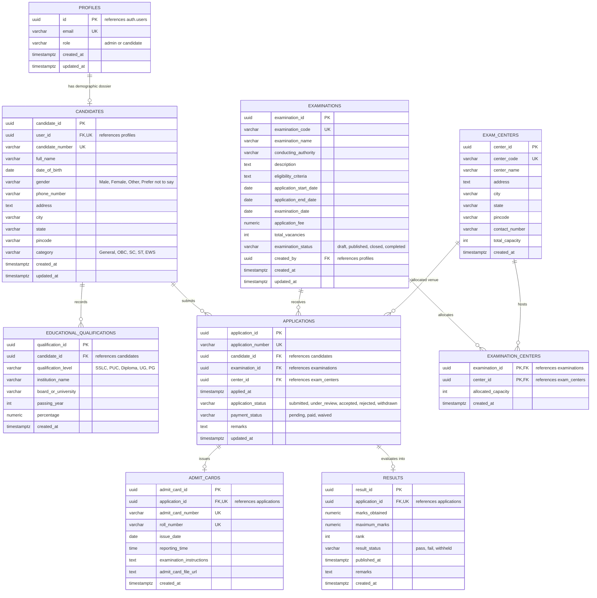

# Entity-Relationship (ER) Diagram
## Government Recruitment Examination Management System (GREMS)

The following Mermaid ER diagram illustrates all **9 core relational tables**, their primary keys, foreign keys, attribute data types, and cardinality multipliers.

---

## Academic Cardinality Legend

| Notation | Relationship Type | DBMS Implementation |
| :--- | :--- | :--- |
| `PROFILES ||--o| CANDIDATES` | Exactly One-to-Optional One (1 : 0..1) | `candidates.user_id UNIQUE NOT NULL REFERENCES profiles(id)` |
| `CANDIDATES ||--o{ EDUCATIONAL_QUALIFICATIONS` | One-to-Many (1 : N) | `educational_qualifications.candidate_id REFERENCES candidates(candidate_id)` |
| `CANDIDATES ||--o{ APPLICATIONS` | One-to-Many (1 : N) | `applications.candidate_id REFERENCES candidates(candidate_id)` |
| `EXAMINATIONS ||--o{ APPLICATIONS` | One-to-Many (1 : N) | `applications.examination_id REFERENCES examinations(examination_id)` |
| `EXAMINATIONS ||--o{ EXAMINATION_CENTERS }o--|| EXAM_CENTERS` | Many-to-Many (M : N) | Composite Key `(examination_id, center_id)` on `examination_centers` |
| `APPLICATIONS ||--o| ADMIT_CARDS` | One-to-Optional One (1 : 0..1) | `admit_cards.application_id UNIQUE NOT NULL REFERENCES applications(application_id)` |
| `APPLICATIONS ||--o| RESULTS` | One-to-Optional One (1 : 0..1) | `results.application_id UNIQUE NOT NULL REFERENCES applications(application_id)` |

